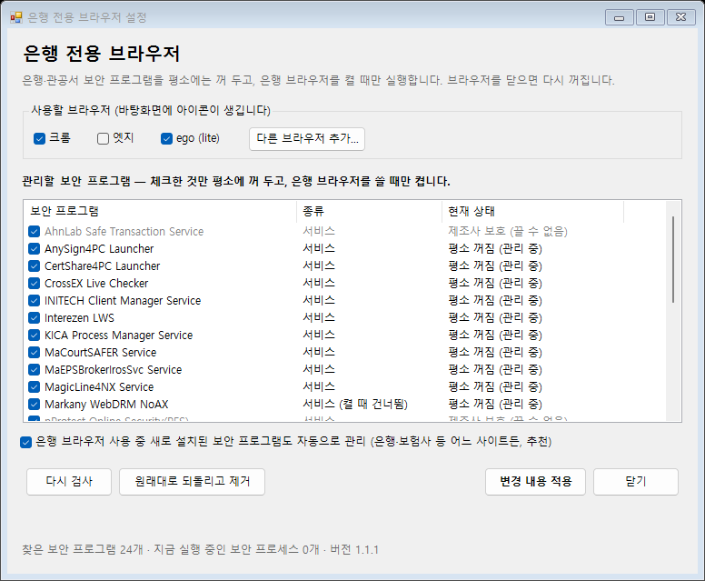

# 은행 전용 브라우저

인터넷 뱅킹·정부24·홈택스 때문에 깔린 보안 프로그램(AnySign, Veraport, IPinside, MagicLine, CrossEX 등)이
컴퓨터를 켤 때마다 돌아가서 PC가 느려지죠?

이 프로그램은 보안 프로그램을 **지우지 않고 평소엔 꺼 두었다가**, 은행 브라우저를 열 때만 켜고 닫으면 다시 꺼 줍니다.

- 보안 프로그램을 **지우지 않습니다.** 평소에는 꺼 두기만 합니다.
- 바탕화면의 **[은행 브라우저]** 아이콘을 누르면 보안 프로그램이 켜지고 은행 전용 창이 열립니다.
- 은행 창을 모두 닫으면 **보안 프로그램도 자동으로 꺼집니다.**
- 매번 다시 설치할 필요가 없어서 빠릅니다.



## 다운로드

[**최신 버전 다운로드**](https://github.com/qkdrml11/bank-browser/releases/latest) — `BankBrowser.exe` 파일 하나(약 90KB)를 받아서 실행하면 됩니다.

## 이런 분께 추천해요

- 컴퓨터를 켜면 작업 관리자에 AnySign, Veraport, MagicLine 같은 게 잔뜩 떠 있는 분
- 은행 업무는 가끔 하는데 보안 프로그램은 매일 돌아가는 게 싫은 분
- 보안 프로그램을 지웠다가 은행 갈 때마다 다시 까는 게 귀찮은 분

## 효과 (실측)

CPU 20코어 · 메모리 32GB PC에서, 은행 로그인 상태(보안 프로그램 켜짐)와 평소(꺼짐)를 비교했습니다.

| 항목 | 켜짐 | 꺼짐 (평소) | 차이 |
|---|---|---|---|
| 보안 프로세스 수 | 31개 | 6개 | **-81%** |
| 보안 프로세스 메모리 | 559 MB | 113 MB | **446 MB 절약** |
| 보안 프로세스 CPU | 1.29 % | 0.08 % | -94% |
| 실행 중인 보안 서비스 | 14개 | 3개 | -11개 |
| 열려 있는 네트워크 포트 | 22개 | 3개 | **-86%** |
| 스레드 / 핸들 | 433 / 8,422 | 164 / 2,217 | -62% / -74% |

- **메모리 446MB**: 32GB PC에선 체감이 작지만, 8GB 노트북이면 전체 메모리의 5%가 넘습니다. 사양이 낮을수록 효과가 큽니다.
- **네트워크 포트 22개 → 3개**: 보안 프로그램은 은행 사이트와 통신하려고 내 컴퓨터에 작은 서버를 열어 둡니다.
  은행 업무를 안 할 때도 22개가 열려 있던 것을 3개로 줄였습니다. 보안상으로도 더 깔끔합니다.
- **남아 있는 것**: AhnLab Safe Transaction은 제조사가 스스로를 보호해서 끌 수 없습니다.
  MarkAny WebDRM은 한 번 켜지면 재부팅 전까지 꺼지지 않아서, 위 측정의 "꺼짐" 쪽에도 3개(약 56MB)가 남아 있었습니다.
  v1.1.1부터는 이런 프로그램을 은행 브라우저를 열 때 같이 켜지 않으므로, 꺼짐 상태 메모리가 약 57MB까지 줄어듭니다. (예상치, 재측정 전)

## 사용법

1. `BankBrowser.exe`를 실행합니다.
   - "Windows의 PC 보호" 창이 뜨면 **추가 정보 → 실행**을 누릅니다. (개인이 만든 무료 프로그램이라 서명이 없어서 뜨는 창입니다)
2. 사용할 브라우저를 고릅니다. 크롬·엣지·웨일·브레이브·비발디·파이어폭스는 자동으로 찾고, 그 밖의 브라우저는 **다른 브라우저 추가**로 직접 고를 수 있습니다. (여러 개 선택 가능)
3. 찾은 보안 프로그램 목록에서 **평소에 꺼 둘 것**을 체크합니다. (기본: 전부)
4. **설치하기**를 누르고, 컴퓨터를 한 번 다시 시작합니다.
5. 이제 은행·보험·관공서 업무는 바탕화면의 **[은행 브라우저 (브라우저 이름)]**으로 하세요.

설정을 바꾸려면 시작 메뉴의 **은행 전용 브라우저 설정**을, 지우려면 **설정 → 원래대로 되돌리고 제거**
또는 윈도우 **설정 → 앱 → 은행 전용 브라우저 → 제거**를 이용하세요. 제거하면 모든 보안 프로그램이 원래대로 돌아갑니다.

## 알아두실 점

- 평소에 쓰는 크롬/엣지와는 완전히 분리된 창(별도 프로필)입니다. 즐겨찾기·로그인 정보가 섞이지 않습니다.
- **어느 사이트든 됩니다.** 은행·보험사·카드사·증권사 등에서 보안 프로그램 설치를 요구하면 그냥 설치하세요.
  은행 브라우저를 켜 둔 동안 새로 설치된 프로그램은 창을 닫을 때 자동으로 관리 목록에 추가됩니다("자동 추가"로 표시).
  은행 브라우저 사용 중에 다른 프로그램을 설치했다면 그것도 추가될 수 있으니, 설정에서 체크를 빼 주세요.
- **AhnLab Safe Transaction**, **nProtect Online Security** 등 일부 프로그램은 제조사가 스스로를 보호하고 있어서 끌 수 없습니다.
  설정 화면에 "제조사 보호"로 표시됩니다.
- **MarkAny WebDRM**처럼 한 번 켜지면 재부팅 전까지 꺼지지 않는 프로그램은, 처음 은행 브라우저를 닫을 때 자동으로 알아내서
  다음부터는 은행 브라우저를 열 때 같이 켜지 않습니다. 설정 화면에 "켤 때 건너뜀"으로 표시됩니다.
  이런 프로그램은 주로 정부24·법원 등에서 **문서를 출력할 때** 쓰입니다. 출력이 안 되면 사이트 안내에 따라 실행하거나 PC를 재부팅해 주세요.
- 키보드 보안 프로그램의 드라이버 부분은 건드리지 않습니다.
- 윈도우 10/11 (64비트) 전용입니다. 별도 설치 없이 윈도우에 기본으로 들어 있는 .NET Framework 4.x로 동작합니다.

## 동작 방식 (투명하게 공개)

이 프로그램이 컴퓨터에 하는 일은 아래가 전부입니다.

| 하는 일 | 위치 |
|---|---|
| 체크한 보안 서비스의 시작 유형을 "자동 → 수동"으로 변경 | 윈도우 서비스 |
| 체크한 시작프로그램을 "사용 안 함"으로 변경 (작업 관리자 시작프로그램 탭과 같은 방식) | `StartupApproved` 레지스트리 |
| 은행 브라우저를 켤 때 서비스 시작, 닫을 때 종료 | 예약 작업 `\BankBrowser\SvcStart`, `SvcStop` (관리자 확인 창 없이 실행하기 위함) |
| 원래 상태 기록 (되돌리기용) | `C:\ProgramData\BankBrowser\state.json` |
| 프로그램 설치 | `C:\Program Files\BankBrowser\` |
| 은행 브라우저 전용 프로필 | `%LOCALAPPDATA%\BankBrowser\` |

인터넷으로 아무것도 보내지 않으며, 은행 사이트 내용이나 입력값을 읽지 않습니다.
기록(로그)은 `C:\ProgramData\BankBrowser\log.txt`와 `%LOCALAPPDATA%\BankBrowser\log.txt`에 남습니다.

## 빌드

C# (.NET Framework 4.x, WinForms). 외부 라이브러리 없음.

Windows (윈도우에 기본으로 들어 있는 컴파일러로 빌드됩니다):
```
C:\Windows\Microsoft.NET\Framework64\v4.0.30319\csc.exe -target:winexe -out:BankBrowser.exe -win32icon:app.ico -r:System.Management.dll -r:System.ServiceProcess.dll -r:System.Runtime.Serialization.dll -r:Microsoft.CSharp.dll -r:System.Windows.Forms.dll -r:System.Drawing.dll src\*.cs
```

Linux (Mono) — 반드시 .NET Framework 4.8 참조 어셈블리(github.com/mono/reference-assemblies 의 v4.8)로 빌드하세요.
Mono 기본 라이브러리로 빌드하면 윈도우에 없는 메서드를 참조해서 실행 중 오류가 납니다.
```
R=reference-assemblies/v4.8
mcs -nostdlib -noconfig -target:winexe -platform:anycpu -codepage:utf8 -out:BankBrowser.exe -win32icon:app.ico \
  -r:$R/mscorlib.dll -r:$R/System.dll -r:$R/System.Core.dll -r:$R/System.Drawing.dll -r:$R/System.Windows.Forms.dll \
  -r:$R/System.Management.dll -r:$R/System.ServiceProcess.dll -r:$R/System.Runtime.Serialization.dll \
  -r:$R/Microsoft.CSharp.dll -r:$R/System.Xml.dll src/*.cs
```

## 탐지 대상

`src/Engine.cs`의 `Include` 목록에 있는 이름(제조사·제품명)이 서비스 이름, 실행 파일 경로, 시작프로그램 이름에 들어 있으면 보안 프로그램으로 봅니다.
V3 백신 등은 `Exclude` 목록으로 제외합니다. 빠진 프로그램이 있으면 목록에 추가해 주세요.

## 변경 기록

- **v1.1.1** — 한 번 켜지면 재부팅 전까지 꺼지지 않는 보안 프로그램(MarkAny WebDRM 등)은 은행 브라우저를 열 때 같이 켜지 않도록 변경
- **v1.1.0** — 첫 공개 버전

## 주의

- 개인이 만든 무료 프로그램이며, 은행·보안업체와 관계가 없습니다.
- 사용으로 생긴 문제에 대해 책임지지 않습니다. 문제가 생기면 설정 → **원래대로 되돌리고 제거**로 원상복구할 수 있습니다.

## 라이선스

MIT — 자유롭게 쓰고, 고치고, 나눠도 됩니다.
